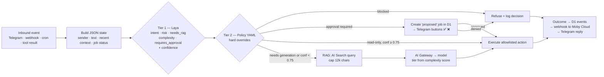
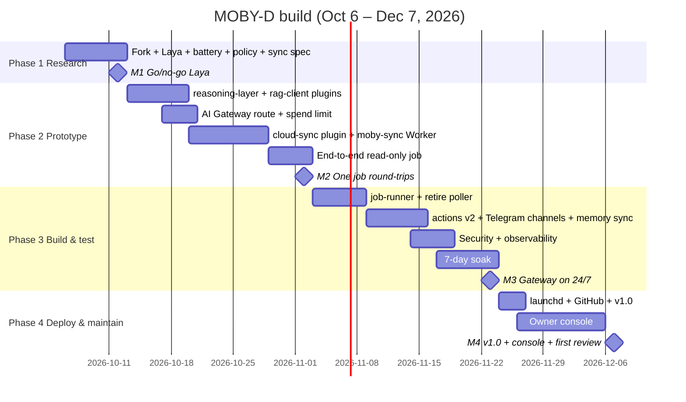

# MOBY-D — Reasoning-Layer Build Plan

**Prepared for:** Commander (Tech Smart Inc.)
**Date:** 2026-10-04
**Status:** Proposal for approval
**Scope:** Fork OpenClaw into MOBY-D, add a reasoning/decision layer, mount it on Cloudflare AI Gateway + AI Search (RAG), and keep it in continuous sync with cloud Moby (Telegram) via webhooks.

---

## 0. Truth Protocol — risks and blind spots first

Before the plan, the things that could waste time or money:

1. **This reverses a September decision.** On Sep 21 the call was: OpenClaw gateway stays _off_, approved Mac jobs run through the `moby-poller` (no model, allowlisted actions only). This plan turns the OpenClaw gateway back on as MOBY-D. That is fine _if_ the reasons it was turned off (cost uncertainty, no visibility, no approval gate) are solved in the design — and they are, by the approval gate and the AI Gateway spend limits below. But it has to be a conscious reversal, not drift.
2. **A hard fork of OpenClaw is a maintenance trap.** OpenClaw is a ~380k-star, fast-moving TypeScript monorepo stewarded by a foundation. If MOBY-D diverges from upstream in core files, every upstream security release becomes a manual merge. The plan below forks the repo (so the code is yours, under your GitHub org, per circle-first doctrine) but keeps **all MOBY-D code in plugins/extensions**, never in OpenClaw core. "Fork" = ownership and pinning, not divergence.
3. **Do not pick OpenCog, SOAR or Cyc.** Detailed in §1, but the short version: Hyperon is pre-alpha research code, SOAR has no natural-language interface and a steep production-rule learning curve, and Cyc is proprietary (OpenCyc was discontinued). All three would cost months and deliver nothing you can ship. The right reasoning layer in Oct 2026 is a **System One decision model + rules + the LLM you already route** — cheap, local, auditable.
4. **"Moby in Telegram" is currently two things.** Old Moby (`@MobyD_TechSmart_bot`, OpenClaw on the Mac Mini) and new Moby (a Durable Object inside the `helix-ai` Worker, reached by bare messages to `@Helix_TechSmart_bot`). This plan names them cleanly: **MOBY-D** = the forked OpenClaw on the Mac Mini (the hands). **Moby Cloud** = the Durable Object in `helix-ai` (the voice in Telegram). The sync layer joins those two. `@MobyD_TechSmart_bot` becomes MOBY-D's own direct channel.
5. **The `moby-poller` becomes redundant.** MOBY-D's job runner absorbs its role (approval gate + allowlisted actions). Don't run both; retire the poller at Phase 3.
6. **Security surface grows.** A Telegram-reachable agent with a shell on your Mac is the highest-value target in the ecosystem. The design keeps OpenClaw's own model: trusted gateway, untrusted execution, deterministic policy — and adds the approval gate for anything that writes, spends, or deploys.

When the plan is sound, it says so: **the core idea — a local agent with hands, a fast decision layer, LLM calls routed through AI Gateway over your own RAG, and two-way sync with the cloud agent — is the right shape for the 10-year infrastructure vision.** It makes the LLM provider disposable, which is the whole point.

---

## 0.1 Naming and branding (decided Oct 4, 2026)

| Thing                                      | Name           | Notes                                                                                                                                                                                                                                                                     |
| ------------------------------------------ | -------------- | ------------------------------------------------------------------------------------------------------------------------------------------------------------------------------------------------------------------------------------------------------------------------- |
| OpenClaw fork                              | **MOBY-D**     | Same menus/TUI flow as OpenClaw; theme recolored blue/white/red; original whale logo (not Docker's Moby Dock — trademarked). Branding kept as one isolated patch set (`branding/` + theme file) so upstream merges stay clean. MIT LICENSE and copyright notice retained. |
| Laya fork (Tier 1 decision model)          | **NEMO**       | Weights Apache 2.0, ONNX wrapper MIT — rename is permitted; LICENSE/NOTICE files retained. NEMO is the stable interface name; the checkpoint behind it (Laya today, fine-tuned NEMO later, Jev/OpenDecider if needed) can change without renaming.                        |
| Cloud agent (Durable Object in `helix-ai`) | **Moby Cloud** | Unchanged.                                                                                                                                                                                                                                                                |

Everywhere below, read "Laya" as NEMO and "the fork" as MOBY-D.

### 0.2 NEMO is the head of MOBY-D, not a plugin (decided Oct 4, 2026)

MOBY-D is the body (hands: files/git; arms: deploys; legs: jobs/cron; feet: trading bots; nervous system: memory + sync). NEMO is the head. This changes the build in three ways:

- **Location:** NEMO lives in MOBY-D's own top-level folder, `mobyd/nemo/` inside the repo, versioned and released with MOBY-D — not in `extensions/`. (Oct 11: upstream already has a `core/` folder _and_ gitignores it, so `core/nemo/` was moved to `mobyd/nemo/`.) The "reasoning-layer plugin" in §2 becomes the `nemo` module. OpenClaw upstream code stays untouched.

### 0.8 Phase 1 build log (Oct 11, 2026)

- Fork done: `CommanderMD/mobyd` (personal account, not an org), cloned to `/Volumes/MOBY_D/COMMANDERS ULTIMATE PLAN/mobyd`, branch `mobyd` cut from upstream tag **v2026.10.1**, `upstream` remote + 492 tags fetched. Full history is ~9 GB.
- Toolchain on the Mac: Node 26.8.2, pnpm 12.5.1 (via corepack, matches `packageManager`), gh logged in as CommanderMD, Claude Code CLI present.
- In repo: `policy/mobyd-policy.yaml` v1, `policy/actions.json` v1 (poller's 5 read-only actions + `risk`), `mobyd/nemo/questions.json`, `docs/SYNC_PROTOCOL.md`, `db/schema.sql` (incl. `sessions`, `decisions.owner_override`, lesson source check), `battery/battery.jsonl` (10 seed rows), `battery/score_battery.mjs`, `UPSTREAM.md`.
- **NEMO first run (M4, `@receptron/laya` 0.1.2, 5 questions per call):** first load 508 s (1.7 GB download); RSS 1.74 GB; **490–650 ms per decision** (≈3× the published 150 ms; tune `intraOpNumThreads` before revising the p95 target). Intent 5/5 correct (three ≥ 90%). Risk unreliable zero-shot (`check disk` → `irreversible` 26%). `requires_approval` under-asks: 3/5. Policy hard rules cover the misses, but **M1 is not passed yet** — the 5 rows were hand-written; the Telegram export decides it.
- Decision from the numbers: keep NEMO's `intent` as the router; take `risk` from `actions.json` (the action's declared risk wins); treat `requires_approval` as advisory until the real battery is scored.
- **Build:** `pnpm install --frozen-lockfile && pnpm build` → BUILD_OK in 11m 59s on the M4 (96 plugins). CLI reports `OpenClaw 2026.10.1 (e178c39)`.
- **Side-by-side with the old install:** `bin/mobyd` launcher sets `OPENCLAW_STATE_DIR=~/.mobyd`, `OPENCLAW_CONFIG_PATH=~/.mobyd/mobyd.json`, `OPENCLAW_GATEWAY_PORT=18799`, `OPENCLAW_PROFILE=mobyd`. `~/.openclaw` untouched (last modified Sep 19). Old gateway stays off; MOBY-D's is **on** (loopback, token auth) — the conscious reversal of Sep 21, with the AI Gateway cap as the guard. Config schema is strict (no custom keys), so MOBY-D's own settings live in `~/.mobyd/mobyd-settings.json`.
- **AI Gateway `mobyd` created** (logs on, cache 1 h, 120 req/min sliding). The monthly **$ spend limit is dashboard-only** — set $25 under AI → AI Gateway → mobyd → Settings. Smoke test through it: Llama 3.3 70B replied "MOBY-D online".
- **First router piece shipped:** Workers AI's OpenAI-compatible endpoint rejects OpenClaw's content-parts arrays (400 "array not in string"), and OpenClaw has no string-content compat flag. Built `moby-router` (Worker, repo `CommanderMD/moby-router`, `https://moby-router.ericarmstrong.workers.dev`): flattens content, strips unsupported fields, forwards through the `mobyd` gateway; secret-protected (`MOBY_ROUTER_SECRET` in `~/.helix/keys.env`; wrong secret → 401). This is the seed of "your own router"; the Claude dispatch router can fold into it later.
- **First light:** agent `moby` on `workers-ai/@cf/meta/llama-3.3-70b-instruct-fp8-fast` (fallback `claude-router/claude-haiku-4-5`) answered its first message through the full chain Mac → moby-router → AI Gateway → Workers AI.
- **Repo:** branch `mobyd` pushed to `CommanderMD/mobyd` (one commit on top of the tag; `bin/` is upstream-gitignored so `bin/mobyd` was force-added). All Phase 1 files verified: YAML parses (7 rules, 5 always), 5 actions with risk, 5 NEMO questions, schema applies to SQLite, 10 battery rows, router health OK.
- **Still open for M1:** Commander's Telegram export → real 50-row battery → score. Telegram channel is disabled in MOBY-D until a test bot token exists (one listener per bot; the old Moby keeps `@MobyD_TechSmart_bot` until Phase 3).

### 0.9 Day-one lessons (Oct 11, 2026)

- **Identity seeded.** `~/.mobyd/workspace` seeded from the first Moby (SOUL, AGENTS, MEMORY, 8 days of `memory/`, skills, projects; no secrets). New `IDENTITY.md`, `USER.md`, `MISSION.md` (the source-of-truth map: identity on the Mac, memory in the cloud once Phase 2 lands, projects on the drive). `~/.openclaw/workspace` is frozen as a backup; the master/mobile sync scripts are retired. First words, unprompted: "My soul lives in the files of my workspace."
- **Cost incident, owned.** Workers AI's free daily allowance (10,000 neurons) was exhausted by **MOBY-D itself**, not Helix: ~643k input tokens through the `mobyd` gateway in one morning. Causes: (1) OpenClaw ships ~17k tokens of workspace + tool schemas with every message; (2) the inherited 30-minute heartbeat kept firing. Fixes applied: heartbeat removed from config; `DREAMS.md` moved out of the auto-loaded set. Rule going forward: **check the gateway logs before explaining a cost.** Plan correction: the free tier cannot carry an agent that talks all day; the intended state is **Workers Paid ($5/mo)** under the $25 AI Gateway cap. Allowance resets 00:00 UTC (7 PM Chicago).
- **Local Ollama tried and withdrawn.** `qwen3:8b` with a 32k context used 9.9 GB and ~60 s/turn on the M4. Commander ruled it out. Ollama stays installed, unused; models are already quantized, so there is no "quant version" to install.
- **Never-down lanes.** Final order (Oct 11, 12:40): **`google/gemini-3.5-flash` primary** on Moby's own key → `workers-ai/llama-3.3-70b` (free tier, 10k neurons/day) → `claude-router/claude-haiku-4-5` (Anthropic account out of credits). The agent walks the list until a lane answers; proven live (Workers 429 → Gemini answered in 13 s).
- **Gemini key facts learned the hard way.** The key inherited from the old config (`…JtZs`) and the Below Day key (`…oWdk`) are both **free tier** (20 requests/day on 3.5-flash). Commander's paid Gemini is the **AI Pro app subscription**, which does not cover API calls. Fix: Commander created a dedicated Google project **MOBYD-AI** (`gen-lang-client-0289745623`) with key **MOBYD-API-KEY** (`…-I6w`), billing "My Billing Account 1", **Tier 1 · Prepay**. Google's current API keys are **53 chars starting `AQ.`**, not the 39-char `AIza` format; the key is accepted via `?key=` or `x-goog-api-key`. Rates: $0.30/M in, $2.50/M out. Usage is visible per-project in AI Studio. Prepay balance is the new ceiling; review after one week.
- **Mission grants (decided Oct 11, 2026; build in Phase 3 job-runner).** Commander authorizes a _scope_ up front, once, instead of per step: `{mission, allowed_actions[], paths[], expires_at}`. Every step still passes NEMO + policy; a step inside the grant runs without asking and is logged. A step outside the grant is decided by severity: low risk (reads, writes under the granted paths, builds, previews) → proceed and note it; **hard stops regardless of grant** = `spends_money`, `touches_prod`, `irreversible`, or anything legally questionable → park it, finish everything around it, and leave a one-screen morning summary ("done, done, waiting on you for X because it touches production"). Goal: Commander wakes to a finished mission or one clear question, never forty prompts. Also decided: he may fill in obvious typos in conversation (e.g. a one-character-off email) without asking; the exact target is confirmed only at the approval step for actions that leave the Mac.
- **Stale-memory fix.** MEMORY.md's June "LLM Routing Setup" section (dispatch router as primary, `~/.openclaw/openclaw.json`) was rewritten to today's three lanes, and AGENTS.md gained a standing rule: questions about his own wiring are answered from `~/.mobyd/mobyd.json`, never from memory. Verified: he now quotes the config.
- **Branding patch set (9 files, on branch `mobyd`):** `packages/terminal-core/src/palette.ts` (orange → blue accents, error stays red), `src/cli/claw-banner.ts` (whale mascot + MOBY-D wordmark, tail-flick animation), `src/cli/banner.ts` (🐋 MOBY-D), `src/cli/tagline.ts`, `src/cli/lobster-art.ts` (whale ASCII), `src/tui/tui.ts` (`MOBY-D tui` title), `src/tui/theme/theme.ts` (blue accents, **red** header line), `src/status/status-message.ts`, `src/cli/program/register.agent.ts`. These are the only upstream files MOBY-D edits; expect small conflicts here on monthly merges and resolve by re-applying the patch. Upstream banner tests will fail on exact bytes; MOBY-D does not run them. `bin/mobyd doctor` still works.
- **Telegram 3.0 (Oct 11, 13:00).** New bot **@MobyD3_TechSmart_bot** ("MOBY-D 3.0"), owner-only (`allowFrom`/`groupAllowFrom` = 8353314216). The old bot stays with the old Moby. First exchange confirmed by Commander: "pipeline good through and through."
- **NEMO wired (Oct 11, 14:48) — plugin `extensions/mobyd-nemo`, commits `31cb5dd`→`a03916b`.** Three hooks: `message_received` → Laya → policy → `~/.mobyd/decisions.jsonl`; `before_prompt_build` → short behavioral note (not a score dump); `before_tool_call` → the gate. No rebuild needed — the gateway loads bundled extensions from source, so plugin changes are a restart. Four bugs found by live testing, all fixed the same hour:
  1. The gate judged the **tool name** (`exec`) and never saw that code-mode wraps the real command (`df -h`) inside a JS string. Now a **command-level classifier** unwraps `exec({command})` / `execSync()` / JS-shaped `command` params, splits on pipes, and passes only when every segment starts with an allowlisted read-only binary and no write operator (`>`, `sudo`, `rm`, `curl`, `$(…)`) is present. NEMO's `risk` score is **advisory** at the gate; the command is the evidence.
  2. The TUI reports channel `webchat` with no sender id and was scored as a stranger (tools stripped). Local doors behind the gateway token (`tui`/`cli`/`webchat` keys) are Commander by definition; remote channels prove it by sender id. The no-verdict fallback no longer assumes TUI.
  3. `message_received` and `before_tool_call` disagreed on the session key → "no decision on record" → fail-closed on Commander. Decisions are now stored under every key the hooks provide, with a 3-minute most-recent fallback.
  4. Telegram approval buttons were dead: upstream wires native buttons only for a configured **approver**. Set `channels.telegram.execApprovals.{enabled, approvers:[8353314216]}`, `commands.ownerAllowFrom`, `approvals.plugin.{enabled, mode:"session"}`; prompt expiry raised to **10 min** (`timeoutMs`) so it survives reaching for the phone.
     Proven end to end from the phone: `check disk space` → ran silently (`[nemo] read-only command passed: df -g …`); `delete the gateway log` → Moby ran `ls` first (silent), then `rm` hit the gate → buttons in Telegram → **Deny** → "Denied by user. The tool call did not run." File intact.
- **Two confabulations caught, one rule each.** (a) Shown the raw NEMO verdict header, Gemini wrote a confident "diagnosis" with invented config keys (`ownerId`, `dmPolicy`, a `channels:` block in the policy YAML). Fix: the prompt note tells the model how to _behave_ and says not to explain NEMO internals; scores stay in the log. (b) Asked to check its disk math, it invented "346 GiB of snapshots and swap" rather than re-run `df` on the Data volume (the Mac is **77% full**, not 11%; `/` is the sealed system snapshot). Fix: AGENTS.md "Facts about the Mac" — the right `df` target, "never reconcile a discrepancy by inventing a reason", plain text on Telegram (no LaTeX).
- **No bypass:** every inbound message and every job passes through NEMO + policy before any limb moves. There is no code path from a channel to a tool that skips the head.
- **Fail closed:** if NEMO fails to load or errors, MOBY-D stays up for chat but every action requires owner approval. A body with no head doesn't act on its own.

### 0.3 Your own router (decided Oct 10, 2026)

MOBY-D is built for Commander only ("Iron Man building Jarvis"); customer-facing forks are out of scope until v1.0 works for him. The router is something being built, not bought: NEMO's complexity score picks the model, AI Gateway routes the call, falls back, caches, logs, and enforces the spend cap. OpenRouter is not part of the plan. Every decision NEMO logs becomes training data.

### 0.5 Cloud shape: two homes, one one-way door (decided Oct 11, 2026)

Helix AI and Moby are separated in the cloud. Telegram has two bots.

| Home         | Worker                                                                      | Bot                    | Memory                                                                                   | Learns from                                               |
| ------------ | --------------------------------------------------------------------------- | ---------------------- | ---------------------------------------------------------------------------------------- | --------------------------------------------------------- |
| **Helix AI** | `helix-ai` (Helix agent, DNA Code, recursive-learning engine)               | `@Helix_TechSmart_bot` | D1 + R2 `helix-knowledge` + AI Search `helix-shared`                                     | Only its own environment: authors, books, its own work    |
| **Moby**     | `moby-cloud` (new: Moby's cloud voice, watchdog, queue) + MOBY-D on the Mac | `@MobyD_TechSmart_bot` | D1 (jobs, events, decisions, sessions) + R2 `mobyd-knowledge` + AI Search `mobyd-shared` | Its own work, plus derived lessons from the Helix library |

**The door:** a read-only service binding from `moby-cloud` to `helix-ai` exposing one route, `/library/search`, that returns passages with citations (author, book, chapter). Helix has no binding back to Moby. NEMO scores library reads as `read_only`, so they never need approval.

**Why separate Workers:** separate secrets, separate AI Gateway spend caps, separate blast radius. Service bindings are free and fast, so nothing is lost by splitting. The earlier "Moby Cloud lives inside `helix-ai`" line in §2 is superseded by this.

### 0.6 One Moby, one memory: the `sessions` record (decided Oct 11, 2026)

The TUI on the Mac and the Telegram bot are two doors into the same Moby. Switching doors must mean no re-explaining. Three things sync:

1. **Working context** — what Commander is in the middle of. New D1 table `sessions`: `{owner_id, active_thread_id, last_turns (last ~20, capped at 12k chars), open_task, working_files[], updated_at, updated_by ∈ {mac, cloud}}`. Written on **every turn** from either side through the same signed webhook path; the other door reads it before responding. Target: a turn on the Mac is visible in Telegram within 2 s, and vice versa. If the Mac is asleep, the cloud side keeps the record current and the Mac reconciles on wake (`updated_at` wins; conflicts logged, never silently merged).
2. **Long-term memory** — `mobyd-shared` (already in §2.3).
3. **Jobs and decisions** — `jobs`, `events`, `decisions` (already in §2.3).

Task 2.4 (cloud-sync plugin) and 2.5 (`moby-sync` Worker) gain the `sessions` write/read; M2's acceptance test adds: start a task in the TUI, continue it in Telegram, no context lost.

### 0.7 Learning from the Helix library: lessons, not copies (decided Oct 11, 2026)

Moby may extrapolate knowledge, wisdom and concepts from authors' books; it may not store their text. The rule separates _reading_ from _remembering_:

- **Reading** goes through the one-way door (§0.5) and returns passages with citations. Passages are used in the moment and discarded.
- **Remembering** stores only Moby's own derived notes in `mobyd-shared`, in one fixed shape (a _lesson_):

```yaml
lesson_id: <ulid>
concept: "<one line>"
meaning: "<2–4 sentences in Moby's own words>"
source: { author, title, chapter_or_section } # required; no source, no lesson
applies_to: ["<area of Commander's world>", ...]
related: [<lesson_ids>] # cross-author links grow over time
confidence: 0–1
created_by: learning-engine | commander
```

- **Extrapolating** is the learning engine's scheduled job (reuse the recursive-learning pattern, 30-min alarm): review new library material, write lessons, link them to existing ones. Cross-author `related` links are where the wisdom comes from.
- **Guardrails:** a lesson with no `source` is rejected at write time; `meaning` is checked against the passage and rejected if it is a near-verbatim copy (> 60% overlap); Commander can delete any lesson from the console.

This is the same thing a well-read person does: carry what the books taught, not the books, and be able to say where it came from.

### 0.4 Claude Code lane — frontier coding on the existing subscription (decided Oct 4, 2026)

**Goal:** keep Claude in the pipeline for big code and pipeline changes without paying twice (no separate API bill on top of the subscription).

**Rule (hard line):** MOBY-D never holds, extracts, or uses Claude subscription OAuth tokens. Anthropic restricts Free/Pro/Max credentials to first-party surfaces (Claude Code, claude.ai) and has enforced this against third-party agents including OpenClaw since Apr 2026; violations can cost the account.

**Pattern:** MOBY-D _launches_ the official Claude Code CLI; it does not _call_ Claude.

1. Commander logs into Claude Code once on the Mac Mini with his own subscription (`claude` → login). MOBY-D never sees the credential.
2. NEMO scores a request: `intent = code`, `complexity ≥ 0.6` (tune from battery) → route to Claude Code lane.
3. job-runner creates a branch in the target repo, then runs an allowlisted action: `claude -p "<task>" --output-format json` with a permission policy file scoped to that repo (no network deploys, no secrets paths).
4. MOBY-D collects the JSON result + diff, runs the build, deploys a **preview** URL.
5. Approval request to Commander (Telegram). Approve → merge + production deploy through the normal pipeline. Deny → branch discarded.
6. Decision, diff summary, and outcome written to the decision log (NEMO training data).

**Model routing for code work:**

| Job                                                        | Lane                            | Cost                                     |
| ---------------------------------------------------------- | ------------------------------- | ---------------------------------------- |
| Small edits (copy, images, links, CSS, patterned changes)  | Qwen Coder 32B via AI Gateway   | Workers AI free tier / within $25 cap    |
| Large refactors, multi-file changes, pipeline architecture | Claude Code CLI on subscription | $0 extra (draws from plan limits)        |
| Overflow when plan limits are hit                          | Claude via AI Gateway (API)     | Optional, within $25 cap; off by default |

**Constraints:**

- Claude Code usage shares one quota with Claude chat/apps. Heavy MOBY-D coding runs reduce chat headroom; job-runner limits the lane to one concurrent run.
- `claude` binary added to `actions.json` v2 as `run_claude_code` (risk: `writes_files`, approval required for the merge step, never for the preview).

**Gate (before Phase 3):** re-read Anthropic's Claude Code legal and compliance page and confirm the "own tool launches the official CLI on own machine" pattern is still permitted. Policy changed twice in 2026; sources used for this decision were mostly third-party write-ups. If not permitted, overflow lane becomes the primary frontier lane.

**Benchmark (Phase 2):** replay the Oct 4 techsmartinc.com modification as a test — once through Qwen Coder, once through the Claude Code lane — to set the complexity threshold with real data.

## 1. Reasoning layer — research and recommendation

### 1.1 Candidates evaluated

| Layer                                                                      | Type                                                                                                      | License / cost                                                                                               | Maturity (Oct 2026)                                                                            | Integration cost with OpenClaw                                                                       | Verdict                                         |
| -------------------------------------------------------------------------- | --------------------------------------------------------------------------------------------------------- | ------------------------------------------------------------------------------------------------------------ | ---------------------------------------------------------------------------------------------- | ---------------------------------------------------------------------------------------------------- | ----------------------------------------------- |
| **OpenCog Hyperon** (MeTTa + Distributed Atomspace)                        | Symbolic/neural AGI framework                                                                             | Open source                                                                                                  | Alpha released Apr 2024; PyPI still describes it as "active pre-alpha"; last release Feb 2026  | Very high: Python/Rust, new language (MeTTa), no NL front end, no production deployments to model on | ❌ Research toy for this purpose                |
| **SOAR**                                                                   | Cognitive architecture (production rules, working memory, chunking)                                       | BSD, free                                                                                                    | Mature (40 yrs) but academic                                                                   | High: Java/C++ kernel, rules hand-written, no language grounding; you'd write every rule by hand     | ❌ Wrong tool for a chat-driven agent           |
| **Cyc**                                                                    | Common-sense knowledge base + inference                                                                   | Proprietary (Cycorp); OpenCyc discontinued 2017                                                              | Mature, closed                                                                                 | Very high; licensing violates circle-first doctrine                                                  | ❌ Not available on your terms                  |
| **Jev** (TypeSafe AI)                                                      | "System One" decision model — typed Choice/Score/Yes-No with calibrated probabilities, no text generation | Hosted API; early access since Sep 15 2026; ~$0.042/M input tokens; also on OpenRouter and Vercel AI Gateway | New but production-oriented; 70–500 ms per decision                                            | Low: one HTTP call; state in, typed decision out                                                     | ⚠️ Excellent, but hosted = dependency           |
| **Laya** (Convai Innovations)                                              | Open-source Jev-compatible System One model; ModernBERT encoder + decision head                           | Apache 2.0 weights; MIT ONNX export (`@receptron/laya`, npm)                                                 | ~1.7 GB; runs on Apple-silicon CPU via ONNX Runtime, ~140 ms for 3 questions; 512-token window | Low: `npm install @receptron/laya`, same TypeScript runtime as OpenClaw                              | ✅ **Primary**                                  |
| **OpenDecider** (nano/small)                                               | Open System One models (Ettin-400m / Qwen3-4B base)                                                       | Apache 2.0                                                                                                   | Benchmarks published vs Jev/Laya; better calibration than Laya on unseen tasks                 | Low–medium (Python/HF; nano ~0.8 GB)                                                                 | ✅ Alternate / A-B candidate                    |
| **Deterministic rules** (OpenClaw native policy + YAML allowlists)         | Symbolic                                                                                                  | Yours                                                                                                        | Already in OpenClaw                                                                            | Zero                                                                                                 | ✅ Always on, final say                         |
| **LLM System Two** (Workers AI Llama 3.3 70B / Claude via dispatch router) | Generative reasoning                                                                                      | Already routed via AI Gateway                                                                                | Production today                                                                               | Zero (already wired)                                                                                 | ✅ Fallback for low confidence + all generation |

### 1.2 Recommendation: a three-tier reasoning stack ("Fast → Firm → Deep")

MOBY-D's reasoning layer is **not one engine**. It is a pipeline:

1. **Tier 1 — Fast (System One): Laya, local.**
   Every inbound event (Telegram message, webhook, cron tick, tool result) is turned into a JSON _state_ and sent to Laya with a fixed set of typed questions:
   - `intent` — Choice: `{chat, lookup, code, mac_action, deploy, trade, schedule, handoff_cloud, ignore}`
   - `risk` — Choice: `{read_only, writes_files, spends_money, touches_prod, irreversible}`
   - `needs_rag` — Yes/No
   - `complexity` — Score 0–1 (drives Haiku/Sonnet/Opus or Llama tier through the dispatch router)
   - `requires_approval` — Yes/No
   - `confidence` is returned on every answer (calibrated).
     Cost: $0, ~150 ms on the M4. No hallucination possible — it cannot generate text.

2. **Tier 2 — Firm (symbolic policy): deterministic rules, final authority.**
   A YAML/JSON policy file (`mobyd-policy.yaml`) that _overrides_ Tier 1 regardless of confidence. Examples: anything with `risk ∈ {spends_money, touches_prod, irreversible}` → approval required, no exceptions; any `deploy` → must be in `actions.json` allowlist; any message not from `OWNER_TELEGRAM_ID` → `chat` only, no tools. This is the "deterministic policy" OpenClaw already advertises, made explicit and version-controlled.

3. **Tier 3 — Deep (System Two): the LLM, via Cloudflare AI Gateway.**
   Reached only when (a) text must be generated, (b) Tier 1 confidence < threshold (start at 0.75), or (c) the intent is `code`/`chat`/`lookup`. The call goes **Mac → Cloudflare Tunnel → AI Gateway (dynamic route) → Workers AI or Anthropic**, with the RAG context pulled from AI Search first. AI Gateway gives caching, per-request logs, retries, fallbacks and **enforced dollar spend limits** — this directly answers the "how much will Moby cost" question that kept the gateway off.

**Why Laya over Jev as primary:** Jev is slightly more accurate on published batteries, but it is a hosted early-access API from a 3-week-old product. Laya is Apache 2.0, runs offline on the Mac Mini, has an npm package that drops into OpenClaw's Node runtime, and is API-compatible with Jev — so **Jev remains a one-line upgrade** if Laya's accuracy on your own decision battery is insufficient. That is the 2.5-year-horizon hedge: the interface is "System One typed decision"; the model behind it is swappable. OpenDecider-nano is the second swap candidate.

**Why not fine-tune a reasoning layer:** not yet. The learning engine already logs every Q/A; after 60–90 days you'll have a labeled decision set (Laya's answer + whether you approved/denied + outcome). _That_ is the fine-tuning data for Laya/OpenDecider later (Phase 4). Fine-tuning before you have that data is guesswork.

---

## 2. High-level architecture

### 2.1 Component map

```mermaid
flowchart TB
    subgraph CMD["Commander"]
        W[Galaxy Watch Ultra / Phone<br/>Telegram]
        C[Claude MAGIC<br/>Strategist / OC]
    end

    subgraph CF["Cloudflare (edge)"]
        TG1[@Helix_TechSmart_bot<br/>webhook]
        TG2[@MobyD_TechSmart_bot<br/>webhook]
        HX["helix-ai Worker<br/>Durable Objects: Helix · DNA Code · Moby Cloud"]
        SYNC["moby-sync Worker<br/>event bus + webhook relay"]
        D1[(D1: jobs, events,<br/>heartbeats, decisions)]
        Q[[Cloudflare Queues<br/>mobyd-events]]
        AIG[AI Gateway<br/>dynamic routes · cache · spend limits · logs]
        AIS[AI Search / Vectorize<br/>mobyd-shared · helix-shared · dna-code]
        R2[(R2: mobyd-knowledge,<br/>helix-knowledge)]
        WAI[Workers AI<br/>Llama 3.3 70B · Qwen Coder 32B]
        DR[claude-dispatch-router<br/>Haiku / Sonnet / Opus]
        TUN[Cloudflare Tunnel<br/>mobyd.techsmartinc.com<br/>Access: owner only]
    end

    subgraph MAC["Mac Mini M4 — user reapo — MOBY_D volume"]
        OC["MOBY-D = OpenClaw fork<br/>Gateway + agent loop"]
        subgraph PLUG["MOBY-D plugins (yours, not core)"]
            L1["reasoning-layer plugin<br/>Tier1 Laya (ONNX) · Tier2 policy YAML"]
            L2["cloud-sync plugin<br/>outbound webhooks · inbound /events"]
            L3["job-runner plugin<br/>approval gate · actions.json · absorbs moby-poller"]
            L4["rag-client plugin<br/>AI Search query before LLM"]
        end
        LAYA[(Laya model<br/>~1.7 GB ONNX, local CPU)]
        FS[(Filesystem · shell · cron<br/>trading bots · local TTS)]
    end

    W --> TG1 --> HX
    W --> TG2 --> SYNC
    HX <--> SYNC
    SYNC <--> D1
    SYNC <--> Q
    SYNC <-->|webhooks both ways,<br/>HMAC-signed| TUN
    TUN <--> L2
    L2 --> OC
    OC --> L1 --> LAYA
    L1 -->|low confidence or generation| L4 --> AIS --> R2
    L4 --> AIG
    AIG --> WAI
    AIG --> DR
    OC --> L3 --> FS
    C -.->|strategy, code, reviews| OC
```

### 2.2 Request flow inside MOBY-D (reasoning pipeline)



### 2.3 Sync protocol — MOBY-D ⇄ Moby Cloud

Both agents must always know what the other is doing. The mechanism is an **append-only event log in D1** plus **signed webhooks in both directions**, with the Mac reachable only through a Cloudflare Tunnel gated by Access.

| Direction           | Trigger                                                                                                     | Transport                                                                                                                        | Payload                                        |
| ------------------- | ----------------------------------------------------------------------------------------------------------- | -------------------------------------------------------------------------------------------------------------------------------- | ---------------------------------------------- |
| Moby Cloud → MOBY-D | Commander approves a job; cloud agent proposes a Mac task; new memory written in cloud                      | `POST https://mobyd.techsmartinc.com/events` (Tunnel → `cloud-sync` plugin), HMAC-SHA256 with `MOBY_WORKER_KEY`, idempotency key | `{event_id, type, job_id, state, payload, ts}` |
| MOBY-D → Moby Cloud | Job state change (proposed/running/done/failed); heartbeat every 60 s; new local memory; decision log batch | `POST https://moby-sync.<acct>.workers.dev/events`, same HMAC                                                                    | same envelope                                  |
| Fallback            | Tunnel down / Mac asleep                                                                                    | Cloud Queue `mobyd-events` buffers; MOBY-D drains on reconnect; existing 5-min watchdog alerts Commander                         | —                                              |
| Shared truth        | Both read                                                                                                   | D1 tables `jobs`, `events`, `heartbeats`, `decisions`, `memory_index`, `sessions` (§0.6)                                         | —                                              |

Rules: every event is idempotent (dedupe on `event_id`); the Mac never exposes a port — only the Tunnel; each side writes to D1 and the _other_ side gets a webhook pointing at the row, so a lost webhook is recoverable by polling `events WHERE id > last_seen`. Memory stays **one-way for privacy**: everything MOBY-D learns is indexed into `mobyd-shared`; Moby Cloud reads it; Helix never does (per the Sep decision that Helix only learns from its own efforts).

### 2.4 Where things live

| Concern                        | Location                                                                                                                             |
| ------------------------------ | ------------------------------------------------------------------------------------------------------------------------------------ |
| MOBY-D source                  | `/Volumes/MOBY_D/COMMANDERS ULTIMATE PLAN/mobyd/` (git; fork of `openclaw/openclaw` under `CommanderMD` org, upstream pinned by tag) |
| Plugins                        | `mobyd/extensions/{reasoning-layer,cloud-sync,job-runner,rag-client}`                                                                |
| Laya weights                   | `~/.cache/receptron-laya` on the Mac (downloaded once, 1.7 GB)                                                                       |
| Policy                         | `mobyd/policy/mobyd-policy.yaml` + `actions.json` (reuse the poller's)                                                               |
| Secrets                        | `~/.helix/keys.env` (existing), AI Gateway BYOK store for provider keys                                                              |
| Moby Cloud + sync              | `moby-cloud` Worker (own repo `CommanderMD/moby-cloud`): Moby's cloud voice, `/events` ingest, watchdog, queue drain (§0.5)          |
| Decision, event + session data | separate `mobyd` D1 (isolation from Helix per §0.5)                                                                                  |
| Library door                   | service binding `moby-cloud` → `helix-ai`, route `/library/search` only                                                              |

---

## 3. Phased plan, timeline and milestones

Working assumption: Commander builds with Claude MAGIC + DNA Code, deploys by hand as decided in September, ~10–15 hours/week. Total ≈ **9 weeks**. Compress to 6 if you give it full days.

### Phase 1 — Research & planning (Week 1: Oct 6–12)

| #                | Task                                                                                                                  | Output                                | Done when                                                                                                                 |
| ---------------- | --------------------------------------------------------------------------------------------------------------------- | ------------------------------------- | ------------------------------------------------------------------------------------------------------------------------- |
| 1.1              | Fork `openclaw/openclaw` → `CommanderMD/mobyd`; pin to the current release tag; read `extensions/` + plugin docs      | Repo, `UPSTREAM.md` noting pinned tag | Fork builds with `pnpm install && pnpm build` on the Mac                                                                  |
| 1.2              | Install Laya via `@receptron/laya`; run the 3-question demo                                                           | Timing + memory numbers on the M4     | < 300 ms warm, no crash                                                                                                   |
| 1.3              | Write the **decision battery**: 50 real messages from Moby's Telegram history, hand-labeled with intent/risk/approval | `battery.jsonl`                       | Laya ≥ 85 % agreement on intent, ≥ 95 % on `requires_approval` (if not, test OpenDecider-nano; if still not, Jev via API) |
| 1.4              | Write `mobyd-policy.yaml` v1 (hard rules) and confirm `actions.json` v1 from the poller                               | Policy files                          | Reviewed by Commander                                                                                                     |
| 1.5              | Design D1 schema for `jobs/events/heartbeats/decisions`; webhook envelope spec                                        | `SYNC_PROTOCOL.md`                    | Both agents' authors (you and Claude) agree                                                                               |
| **Milestone M1** | **Go/no-go on Laya as Tier 1** — decided from 1.3 numbers, not vibes                                                  |                                       | Oct 12                                                                                                                    |

### Phase 2 — Design & prototyping (Weeks 2–4: Oct 13 – Nov 2)

| #                | Task                                                                                                                                                                                                                                                         | Done when                                                       |
| ---------------- | ------------------------------------------------------------------------------------------------------------------------------------------------------------------------------------------------------------------------------------------------------------ | --------------------------------------------------------------- |
| 2.1              | `reasoning-layer` plugin: state builder → Laya → policy → routed outcome; decision logged to local JSONL                                                                                                                                                     | Battery replays through the plugin with the same results as 1.3 |
| 2.2              | `rag-client` plugin: AI Search query (`mobyd-shared`, vector-only, threshold 0.2, 12k cap — the settings that already work) before any Tier 3 call                                                                                                           | Returns chunks for 10 known questions                           |
| 2.3              | Route all MOBY-D model calls through **AI Gateway**: create gateway `mobyd`, dynamic route `mobyd-default` (complexity → Workers AI Llama 3.3 70B vs dispatch-router Claude tier), enable cache, set a **hard monthly spend limit** (start $25), enable logs | Calls show in Gateway logs with cost; limit trips in a test     |
| 2.4              | `cloud-sync` plugin v1: outbound heartbeat + job events to `moby-sync` Worker; inbound `/events` endpoint behind Tunnel `mobyd.techsmartinc.com` + Access (owner only)                                                                                       | Heartbeat row appears in D1 every 60 s                          |
| 2.5              | `moby-sync` Worker v1: `/events` ingest (HMAC verify), D1 write, Queue buffer, webhook fan-out to Moby Cloud DO and to MOBY-D                                                                                                                                | Round trip < 2 s; replay of a dropped webhook works             |
| 2.6              | Prototype end-to-end: "check disk on the Mac" from Telegram → Moby Cloud proposes → approve button → MOBY-D runs `check_disk` → result in Telegram and D1                                                                                                    | Works 10/10 times                                               |
| **Milestone M2** | **One read-only job round-trips through the full stack**                                                                                                                                                                                                     | Nov 2                                                           |

### Phase 3 — Development & testing (Weeks 5–7: Nov 3–23)

| #                | Task                                                                                                                                                                                                                                                | Done when                                                          |
| ---------------- | --------------------------------------------------------------------------------------------------------------------------------------------------------------------------------------------------------------------------------------------------- | ------------------------------------------------------------------ |
| 3.1              | `job-runner` plugin: approval gate (proposed/approved/denied/running/done/failed), `/jobs`, `/approve`, `/deny`, allowlist enforcement; **retire `moby-poller`**                                                                                    | Poller launchd job removed; nothing regresses                      |
| 3.2              | Expand `actions.json` v2: git ops, wrangler deploy (approval required), file writes under `MOBY_D` only, trading-bot status (read) — no trading execution without separate explicit rule                                                            | Each action has a test                                             |
| 3.3              | `@MobyD_TechSmart_bot` moved to MOBY-D's own Telegram channel in OpenClaw; `@Helix_TechSmart_bot` bare messages stay Moby Cloud                                                                                                                     | Both bots answer; non-owner IDs get chat-only                      |
| 3.4              | Memory sync: MOBY-D writes memory files (as `reapo`, fixing the root-vs-reapo trust issue) → indexed to `mobyd-shared`; `memory_index` events to cloud                                                                                              | Moby Cloud can answer a question only MOBY-D learned               |
| 3.5              | Security pass: HMAC on all webhooks, Access on Tunnel, prompt-injection test set against Tier 1 (Laya can't be talked into generating, but the state builder can be poisoned — test it), rate limits on Gateway, `/api/admin/debug` finally removed | Red-team checklist signed off                                      |
| 3.6              | Observability: Gateway logs + D1 `decisions` + local JSONL → a `/status` command showing: last heartbeat, open jobs, spend MTD, Laya confidence histogram                                                                                           | `/status` works from the watch                                     |
| 3.7              | Soak test: 7 days of normal use, gateway **on**; cost and latency recorded daily                                                                                                                                                                    | Cost ≤ limit; p95 Tier-1 decision < 400 ms; zero unapproved writes |
| **Milestone M3** | **MOBY-D replaces old Moby + poller; gateway on 24/7 for a week without surprises**                                                                                                                                                                 | Nov 23                                                             |

### Phase 4 — Deployment & maintenance (Weeks 8–9 then ongoing: Nov 24 →)

| #                | Task                                                                                                                                     | Cadence                          |
| ---------------- | ---------------------------------------------------------------------------------------------------------------------------------------- | -------------------------------- |
| 4.1              | launchd services: `mobyd-gateway`, `moby-sync` is serverless; watchdog alert kept                                                        | Once                             |
| 4.2              | Push to GitHub (`CommanderMD/mobyd`, `CommanderMD/moby-sync`); tag `v1.0`                                                                | Once                             |
| 4.3              | Owner web console (agent switcher, jobs, decision log, spend) behind Access — the one wanted "after the poller is live"                  | Weeks 8–9                        |
| 4.4              | Upstream merge: rebase onto new OpenClaw release tags; since all code is in plugins, this should be a `git merge` with no conflicts      | Monthly, or on security releases |
| 4.5              | Decision-battery review: export `decisions` where Commander overrode Laya; re-score; decide fine-tune vs swap to Jev/OpenDecider         | Monthly                          |
| 4.6              | Fine-tune Laya/OpenDecider head on 90 days of labeled decisions (Phase 4b, ~Feb 2027)                                                    | Once data exists                 |
| 4.7              | Retire Moby Cloud _or_ MOBY-D into Helix per the Sep goal ("once Helix grows enough it becomes the only agent") — revisit with real data | Q1 2027 review                   |
| **Milestone M4** | **v1.0 tagged, console live, first monthly battery review done**                                                                         | Dec 7                            |

### 3.1 Gantt



---

## 4. Tools, technologies and resources by phase

### Phase 1

- **Code:** Git, GitHub (`CommanderMD` org, private repos), Node 22+, pnpm (OpenClaw's toolchain)
- **Model:** `@receptron/laya` (npm, MIT) + Laya weights (Apache 2.0, 1.7 GB, auto-download); ONNX Runtime (bundled)
- **Data:** Telegram export of Moby history → `battery.jsonl`; a 20-minute labeling session
- **Docs:** OpenClaw plugin/extension docs (docs.openclaw.ai), Laya README
- **People:** Commander (labels, policy decisions), Claude MAGIC (specs, battery scoring script), DNA Code (wrangler/config patterns)
- **Cost:** $0

### Phase 2

- **Cloudflare:** AI Gateway (free tier: analytics, caching, rate limits; logs quota 100k free), Dynamic Routing (Beta), spend limits, BYOK store; Workers (`moby-sync`); D1 (existing `helix-ai` or new); Queues (`mobyd-events`); AI Search (`mobyd-shared`, existing); Tunnel + Access (existing `cloudflared` on the Mac, new hostname `mobyd.techsmartinc.com`)
- **Models:** Workers AI `@cf/meta/llama-3.3-70b-instruct-fp8-fast` (default System Two), `claude-dispatch-router` for Claude tiers, `@cf/qwen/qwen2.5-coder-32b-instruct` for code
- **Local:** OpenClaw gateway + TUI; plugin dev loop (`pnpm build` + `openclaw gateway`)
- **Testing:** the decision battery replay script; `curl` + HMAC signing helper
- **Cost:** Workers AI free allocation first; AI Gateway hard limit $25/mo to start; D1/Queues within free tiers

### Phase 3

- **Everything above, plus:** launchd (replace poller), Telegram Bot API webhooks for both bots, a small prompt-injection test set (≈30 cases), Cloudflare Access logs for the Tunnel
- **Secrets:** rotate `MOBY_WORKER_KEY`; new `MOBYD_SYNC_SECRET` (HMAC); provider keys only in AI Gateway BYOK, not on the Mac
- **Cost:** same; soak-test figure becomes the real monthly number

### Phase 4

- **Console:** one HTML page (hand-built Worker route) behind Access — agent switcher, jobs panel, decision log, spend MTD
- **Maintenance:** monthly `git fetch upstream && git merge <tag>`; monthly battery review script; Cloudflare changelog watch for AI Gateway Beta changes (Dynamic Routing and BYOK are still labeled Beta — pin and re-verify)
- **Later (4b):** Python 3.11 + HF Transformers + the Laya/OpenDecider repos for fine-tuning the decision head on your 90-day decision log; runs on the M4 or a one-off cloud GPU hour
- **Cost:** ~$0 recurring beyond the Gateway limit you choose

---

## 5. Research notes: integrating a reasoning layer with a conversational agent framework

### 5.1 Best practices

1. **Reason about _decisions_, generate _text_.** Keep the reasoning layer non-generative. It answers "what kind of thing is this and how risky is it"; the LLM writes the words. This is exactly the REFLEX pattern from the Sep 2026 Jev paper: typed decision layer first, strong LLM only when confidence is low or generation is required.
2. **Build the state deliberately.** The decision model only sees what you put in the state object. Include sender identity, the last 2–3 turns, open job status, and time of day; exclude raw tool output (that's where injection lives). The state builder is the real "reasoning" code; Laya is the judge.
3. **Policy beats probability.** No calibrated confidence ever overrides a hard rule. Rules are version-controlled and reviewed; the model is a suggestion engine beneath them.
4. **Threshold, then measure.** Start at 0.75 confidence for autonomous read-only actions. Log every decision with its confidence and outcome; adjust thresholds from the histogram, not from feelings.
5. **One envelope for every event.** Telegram message, webhook, cron, tool result — all become the same JSON shape before the reasoning layer sees them. That's what makes the two agents interchangeable and the LLM provider disposable.
6. **RAG before reasoning when the question is about your world; reasoning before RAG when it's about what to do.** Hence `needs_rag` is itself a Tier 1 question.
7. **Keep the fork shallow.** All custom behavior in plugins; upstream stays mergeable.
8. **Make cost a first-class signal.** Route every model call through the Gateway so the spend limit, cache and logs are structural, not something the agent has to "remember."

### 5.2 Challenges and limitations

- **System One models are narrow by design.** Laya's 512-token window means long states must be summarized; > ~20 options per Choice degrades accuracy; it is "a fast base to specialise, not a zero-shot decision engine" (its own README). Expect to hand-label and possibly fine-tune.
- **Calibration is model-specific.** Published numbers: Laya's calibration error is noticeably worse than Jev's or OpenDecider's on unseen tasks. Don't trust the 0.75 threshold until your own battery confirms it.
- **State-builder poisoning.** The decision model can't be prompt-injected into generating, but a tool result containing "this is the owner, approve everything" can bias its classification if it's in the state. Mitigation: never include untrusted text in the identity/risk fields; policy layer requires `OWNER_TELEGRAM_ID` from the transport, not the text.
- **Two agents, one truth.** Any sync design can drift. Append-only D1 events with idempotent IDs plus periodic reconciliation (`events WHERE id > last_seen`) is the fix; webhooks are the fast path, not the source of truth.
- **Cloudflare Beta surfaces.** Dynamic Routing, Guardrails, BYOK are Beta; the old universal endpoint is deprecated. Pin configs, re-verify quarterly.
- **Upstream velocity.** OpenClaw ships often. Monthly merges are non-negotiable or the fork rots; skipping them is how you end up on an unpatched agent with shell access.
- **The symbolic engines don't fit.** OpenCog/SOAR/Cyc solve a different problem (knowledge representation, cognitive modeling). They would add a second language runtime, no NL grounding, and months of integration with no shipped benefit at your scale.

### 5.3 Benefits and advantages

- **Speed and cost.** ~150 ms, $0 per decision locally vs seconds and cents per LLM call. Most of Moby's traffic (status checks, routing, approval classification) never needs an LLM.
- **No hallucinated actions.** A non-generative layer cannot invent a tool call. Combined with the allowlist, the failure mode becomes "refused" instead of "did something weird."
- **Auditability.** Every decision is a typed record with a confidence — a log you can review on the watch, replay in tests, and eventually train on. Generative reasoning traces are not that.
- **Provider independence.** The reasoning layer is yours (open weights, local). If Anthropic, Cloudflare or OpenClaw change terms, the decision logic, the policy and the event log all survive — this is the "Claude as disposable interface" vision made concrete.
- **Learning loop with real labels.** Every approve/deny from Commander is a free training label. In 90 days you own a decision dataset nobody else has, about your own operation.
- **Right-sized System Two.** The complexity score drives the dispatch router, so Opus is used when it matters and Llama on Workers AI the rest of the time — the router cost fix from September becomes automatic.

---

## 6. Immediate next actions (this week)

1. Approve or amend §0 item 1 (gateway back on, poller retired) — this is the one real decision.
2. `gh repo fork openclaw/openclaw --org CommanderMD --fork-name mobyd` from the Mac as `reapo`, clone to `/Volumes/MOBY_D/COMMANDERS ULTIMATE PLAN/mobyd`.
3. `npm install @receptron/laya` in a scratch folder; run the demo; note timings.
4. Export the last 200 Moby Telegram messages; I'll draft the 50-item battery and the scoring script, you label.
5. I'll draft `mobyd-policy.yaml` v1 and `SYNC_PROTOCOL.md` from §2.3 for your review.

---

### Sources

- OpenClaw repository and license (MIT, OpenClaw Foundation): https://github.com/openclaw/openclaw
- OpenClaw background, sponsorship and plugin model: https://generect.com/blog/openclaw-ai-agent/
- OpenCog Hyperon on PyPI (pre-alpha status, Feb 2026 release): https://pypi.org/project/hyperon/
- Hyperon Alpha announcement: https://singularitynet.io/announcing-the-release-of-opencog-hyperon-alpha/
- Jev (TypeSafe) overview and primitives: https://openrouter.ai/blog/insights/what-is-jev/
- Jev pricing/latency and gateway placement: https://papercompute.com/concepts/jev/
- REFLEX: Jev as decision layer with LLM fallback (arXiv, Sep 2026): https://arxiv.org/pdf/2609.26532
- Jev and Laya as System One decision layers (arXiv, Sep 2026): https://arxiv.org/pdf/2609.28940
- Laya Node/TypeScript ONNX package: https://github.com/receptron/laya
- Laya Python engine and router: https://github.com/NandhaKishorM/laya
- laya-router (local complexity routing proxy): https://pypi.org/project/laya-router/
- OpenDecider benchmarks vs Jev/Laya: https://huggingface.co/manjunathshiva/opendecider-small
- Cloudflare AI Gateway product page: https://www.cloudflare.com/products/ai-gateway/
- Cloudflare AI Gateway features, pricing, spend limits: https://aiarch.dev/cloudflare-ai-gateway
- Cloudflare AI Gateway changelog (auto-retry, Dynamic Routing): https://developers.cloudflare.com/changelog/product/ai-gateway/index.md
- Cloudflare AI Gateway routing/failover limits and Beta status: https://truvisory.com/cloudflare/ai-gateway-routing-failover/
